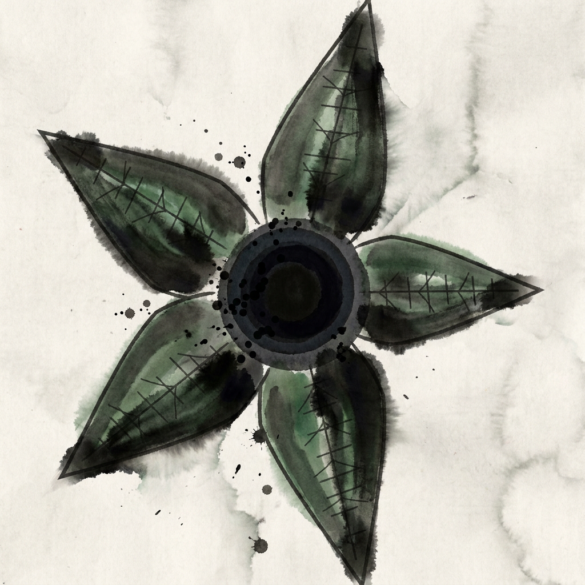

# Memory Garden Tutorial

Transform your personal memories into AI-generated floral artwork through an interactive browser interface.

The original Memory Garden concept and Processing sketch were created by [Alexander Bie](https://scholar.google.com/citations?user=u_gpRfAAAAAJ&hl=da). The web adaptation was built with Claude Code.

Each memory is analyzed across five dimensions: **valence, impact, togetherness, motion, and length**. These features influence the shape, color, and texture of a procedurally generated flower. You can then use Nano Banana Pro to transform the flower into a stylized image.



---

## Step 0 — Download and open the project

1. Open the GitHub repository shared by your teaching assistant (TA).
2. Click the green **Code** button and select **Download ZIP**.
3. Locate the downloaded ZIP file, usually in your **Downloads** folder, and extract it.
4. Open **Visual Studio Code (VS Code)**.
5. Select **File → Open Folder** and open the extracted project folder containing `server.py`.

You should now see the project files, including `server.py` and `README.md`, in the Explorer sidebar.

---

## Step 1 — Install uv (one-time setup)

Run the command for your operating system:

**macOS — Terminal**

```bash
curl -LsSf https://astral.sh/uv/install.sh | sh
```

**Windows — PowerShell**

```powershell
powershell -ExecutionPolicy ByPass -c "irm https://astral.sh/uv/install.ps1 | iex"
```

After installation, **close and reopen your terminal**. If you are using the terminal inside VS Code, restart VS Code as well.

Check that uv is available:

```bash
uv --version
```

If a version number appears, you are ready to continue.

---

## Step 2 — Configure your API token

1. In the VS Code Explorer sidebar, open `.env`.
2. Replace `provided_by_TA` with the **Replicate API token** shared by your TA on Canvas. Keep the variable name `REPLICATE_API_TOKEN` unchanged:

   ```dotenv
   REPLICATE_API_TOKEN=provided_by_TA
   ```

3. Save the file with **Ctrl+S** on Windows or **Cmd+S** on macOS.

This token is used for both memory analysis and image generation. If you update it while the server is running, stop and restart the server to load the new value.

---

## Step 3 — Start Memory Garden

In VS Code, select **Terminal → New Terminal**. Make sure the terminal is in the project folder containing `server.py`, then run:

```bash
uv run --with flask --with replicate server.py
```

Your browser should open [Memory Garden at localhost:8080](http://localhost:8080), with a flower canvas on the left and a control panel on the right.

If the browser does not open automatically, visit [http://localhost:8080](http://localhost:8080) manually. Keep the terminal open while using the application.

---

## Step 4 — Load your memories

1. Select your name from the **Student** dropdown in the upper-right control panel.
2. Click **Load**.
3. Wait for the analysis to finish. The application uses **Gemini-3-flash**, a language model from Google, to analyze your memories and assign values to the five features.
4. Once the memories are loaded, a flower representing one of them will appear on the canvas.

The **Emotional Features** panel displays the values for the memory currently shown:

| Feature | Meaning and range | Visual influence |
| --- | --- | --- |
| **Valence** | Negative or sad (-1) to positive or happy (+1) | Color palette and flower posture |
| **Impact** | Minor (0) to life-changing (1) | Flower size, petal shape, and outline weight |
| **Togetherness** | Alone (0) to deeply social (1) | Petal count and ring spacing |
| **Motion** | Still (0) to physically active (1) | Sway speed and hatching texture |
| **Length** | A brief moment (0) to an extended experience (1) | Stem height and petal curl |

---

## Step 5 — Explore your flowers

Use the following controls to explore your loaded memories:

- **Next:** Click the button in the lower-right corner of the canvas to view the next memory in the original data order. After the last memory, it returns to the first.
- **R:** Press **R** to advance through a shuffled sequence of memories. The sequence is reshuffled when you reach its end. The shortcut is inactive while you are typing in a text field.

The counter in the upper-right corner of the canvas shows the current memory's position in the original data order.

Compare how different memories affect the flowers' appearance. The emotional features guide the visual design, while procedural variation adds differences in color, shape, and texture.

---

## Step 6 — Generate AI artwork

Once you have selected a flower:

1. Under **AI Generation**, choose **Flower Head Only** or **With Stem**.
2. Enter a prompt describing your desired style. You may write in English or Chinese, but **every prompt must include the word `photorealistic`** to maintain a shared visual theme for the class.
3. Click **Generate with Nano Banana**.
4. Wait for Nano Banana Pro to transform the flower. Generation may take a few minutes.
5. The generated image will appear below the button and will be saved automatically in the `MemoryGarden/` folder.

**Example prompts**

- **Tropical:** "Make this into a photorealistic exotic flower growing in a lush tropical rainforest."
- **Arctic:** "Make this into a photorealistic arctic flower with delicate, frost-covered petals."
- **Gothic:** "Make this into a photorealistic flower. 加入哥特式风格，使用深色花瓣与戏剧性的光影。"
- **Cyberpunk:** "Make this into a photorealistic flower with cyberpunk-inspired neon colors and metallic details."

For additional inspiration, explore [Zapier's guide to AI art styles](https://zapier.com/blog/ai-art-styles/).

Experiment with different styles while keeping the shared photorealistic theme. A useful starting phrase is: **"Make this into a photorealistic flower."**

---

## Step 7 — Submit your artwork

1. Generate **3–5 images** and locate them in the `MemoryGarden/` folder.
2. Rename each image using **your full name and a number**, for example, `John_Smith_1.png`.
3. Select your **two favorite images** and upload them to the [shared Google Drive submission folder](https://drive.google.com/drive/folders/1PHOHm_3ZYEWgFXBeFF1Cp2pHJdykf8yY?usp=drive_link).

---

## Quick reference

| Action | Instructions |
| --- | --- |
| Start the server | `uv run --with flask --with replicate server.py` |
| Load your memories | Select your name under **Student**, then click **Load** |
| View the next memory in the original order | Click **Next** in the lower-right corner of the canvas |
| Explore memories in shuffled order | Press **R** while not typing in a text field |
| Generate AI artwork | Enter a prompt containing `photorealistic`, then click **Generate with Nano Banana** |
| Find generated images | Open the `MemoryGarden/` folder |
| Stop the server | Press **Ctrl+C** in the terminal |
